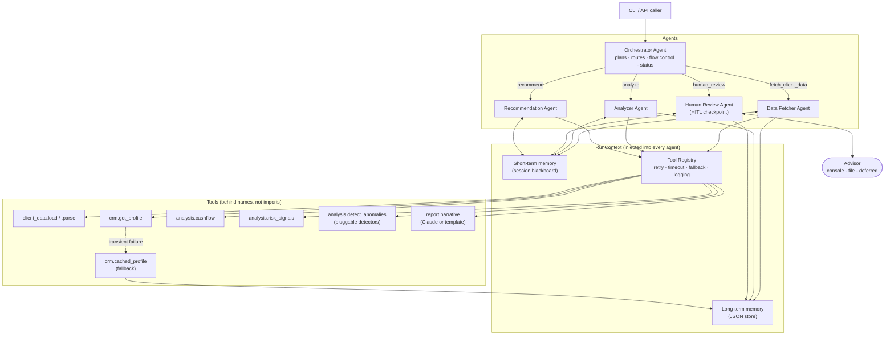
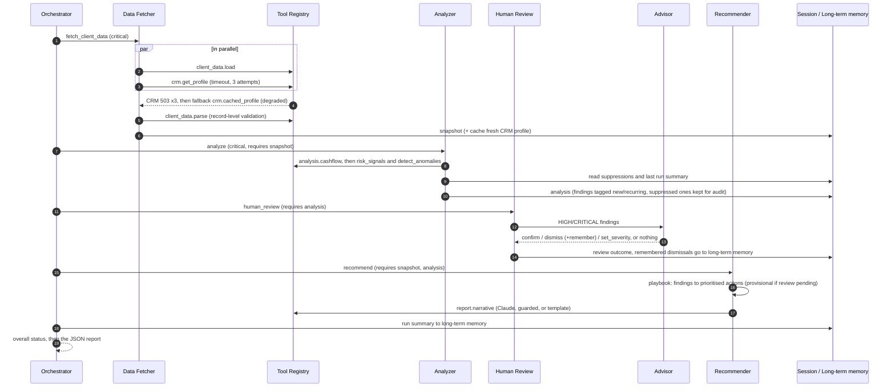

# Wealth Advisor Assistant: a mini multi-agent system

A lightweight multi-agent system that acts as a **Wealth Advisor Assistant**. It ingests a client's
financial data, fetches extra context from a (mock) CRM API, analyses cash flow and portfolio risk,
detects transaction anomalies, asks a human to validate the critical findings, and produces a
**structured, auditable advisory report**.

- **Runs out of the box.** The core is stdlib-only Python (3.10+), with no API keys or services needed.
- **Optional LLM.** Claude can write the advisor briefing (`--llm`). It is sandboxed behind a grounding check and has a deterministic fallback.
- **Bonus items included:** short- and long-term memory, and a human-in-the-loop checkpoint.
- **81 automated tests**, covering the tool layer, detectors, analytics, memory, HITL and end-to-end orchestration.

```
python -m wealth_assistant run C001 --review file --decisions samples/review_C001.json
```

---

## Contents

1. [Quick start](#1-quick-start)
2. [Architecture](#2-architecture)
3. [Agent interactions and flow](#3-agent-interactions-and-flow)
4. [Key decisions and trade-offs](#4-key-decisions-and-trade-offs)
5. [Assumptions](#5-assumptions)
6. [Error handling and edge cases](#6-error-handling-and-edge-cases)
7. [Logging and observability](#7-logging-and-observability)
8. [Memory and human-in-the-loop](#8-memory-and-human-in-the-loop)
9. [Sample input and output](#9-sample-input-and-output)
10. [Project structure](#10-project-structure)
11. [Testing](#11-testing)
12. [Limitations and next steps](#12-limitations-and-next-steps)

---

## 1. Quick start

**Requirements:** Python 3.10 or newer. Nothing else is needed for the core system.

```bash
python -m venv .venv
# Windows: .venv\Scripts\activate    macOS/Linux: source .venv/bin/activate
pip install -e ".[dev]"            # pytest; add ",llm" for the optional Claude narrative
```

You can also skip installation and run `python -m wealth_assistant ...` from the repo root.

### Run it

```bash
python -m wealth_assistant list                                   # C001 C002 C003 C004

# Full review with the bundled reviewer decisions (human-in-the-loop via a file)
python -m wealth_assistant run C001 --review file --decisions samples/review_C001.json

# Interactive review in the terminal (the default when stdin is a TTY)
python -m wealth_assistant run C001 --review interactive

# Resilience demos
python -m wealth_assistant run C002 --crm-outage                   # CRM down: retries, then cached profile
python -m wealth_assistant run C001 --crm-failure-rate 0.5 --seed 3 -v   # flaky CRM: watch the retries
python -m wealth_assistant run C999                                # unknown client: clean failure report

# Lighter plan: transaction monitoring only
python -m wealth_assistant run C001 --plan anomaly_scan

# Long-term memory
python -m wealth_assistant memory show C001
python -m wealth_assistant memory clear C001

# Optional: Claude-written briefing (falls back to the template on any problem)
pip install -e ".[llm]"
export ANTHROPIC_API_KEY=...        # PowerShell: $env:ANTHROPIC_API_KEY="..."
python -m wealth_assistant run C001 --llm
```

Every run writes:

- `output/report_<client>_<run_id>.json`: the structured advisory report
- `logs/run.jsonl`: structured logs (one JSON object per event, keyed by `run_id`)
- `.memory/<client>.json`: long-term memory (run history, CRM cache, reviewer dismissals)

**Exit codes:** `0` completed (with or without warnings), `2` completed but waiting on human review, `1` failed.

| Option | Meaning |
|---|---|
| `--plan full_review \| anomaly_scan` | Which execution plan the orchestrator runs |
| `--review auto \| interactive \| file \| defer \| confirm-all` | How the human checkpoint is served (`auto` = interactive on a TTY, otherwise `defer`) |
| `--crm-outage`, `--crm-failure-rate p`, `--seed n` | Simulated CRM failures (also `WA_CRM_OUTAGE`, `WA_CRM_FAILURE_RATE`) |
| `--llm` | Use Claude for the narrative summary (also `WA_USE_LLM=1`; model via `WA_LLM_MODEL`, default `claude-opus-5-5`) |
| `-v` / `-q` | Show debug logs (every tool call) / hide console logs |

---

## 2. Architecture



### Layers

| Layer | Package | Responsibility |
|---|---|---|
| **Agents** | `wealth_assistant/agents` | Decision-making units with a single responsibility. Each declares `capabilities` and implements `_run`. |
| **Core** | `wealth_assistant/core` | `BaseAgent` (template method: logging context, timing, crash containment), `ToolRegistry` (resilience), `RunContext`, error hierarchy. |
| **Tools** | `wealth_assistant/tools` | Capabilities behind stable names: data access, the CRM adapter, analysis modules, narrative. They raise typed `ToolError`s. |
| **Domain** | `wealth_assistant/domain` | Dataclasses (`Transaction`, `Finding`, `Recommendation`, ...) and validation/parsing of untrusted input. |
| **Memory** | `wealth_assistant/memory` | `SessionMemory` (short-term) and the `LongTermMemory` interface with JSON-file and in-memory backends. |
| **HITL** | `wealth_assistant/hitl` | `Reviewer` strategies: console, file, deferred, auto-confirm. |
| **Composition root** | `wealth_assistant/app.py` | The **only** module that knows the concrete classes and wires them together. |

### The tool abstraction (requirement 3)

Agents never import a concrete tool. They ask for a capability by name:

```python
result = ctx.tools.call("crm.get_profile", client_id=cid)   # -> ToolResult, never raises
if result.degraded: ...                                      # served by a fallback
```

`ToolRegistry` applies a per-tool `ToolPolicy` (timeout, bounded retries with exponential backoff
for *transient* errors only, optional fallback tool) and logs every attempt. The resilience logic
therefore lives in one place, and any implementation can be swapped in `app.py`. For example,
`report.narrative` is bound either to `TemplateNarrativeTool` or to `ClaudeNarrativeTool` with the
template as its fallback. The agent code is identical in both cases.

---

## 3. Agent interactions and flow

Agents do not call each other. The orchestrator routes tasks, and agents exchange data through
**session memory** (a blackboard with per-key provenance). Each plan step declares the keys it
`requires` and `produces`, so the orchestrator can check dependencies before dispatching.



### Plans

| Plan | Steps | Use |
|---|---|---|
| `full_review` | fetch (critical), analyze (critical), review, recommend | Periodic advisory review |
| `anomaly_scan` | fetch (critical), analyze `[cashflow, anomalies]` (critical), review | Fast transaction monitoring |

**Flow-control rules:**

- If a *critical* step fails, the orchestrator aborts, marks the remaining steps `skipped`, and returns a `failed` report. The report is still produced.
- If a *non-critical* step fails, only the steps whose inputs are missing are skipped. The run is `completed_with_warnings`.
- A `pending` human review makes the run `pending_review` (exit code 2). Recommendations still go out, but the ones based on unvalidated findings are marked `awaiting_validation`.
- Overall status precedence: `failed` > `pending_review` > `completed_with_warnings` > `completed`.

### Agents

| Agent | Capability | What it does | Fails how |
|---|---|---|---|
| **Orchestrator** | (coordinator) | Validates the client id and plan, routes steps, checks dependencies, derives status, builds the report, persists the run summary | Never raises. Every outcome is a report. |
| **Data Fetcher** | `fetch_client_data` | Loads client data and CRM profile concurrently, validates records, attaches the profile, caches a fresh profile | `failed` if client data is missing or invalid. `partial` if the CRM is degraded or records were rejected. |
| **Analyzer** | `analyze` | Cash flow, risk signals and anomaly detection (each isolated), applies remembered suppressions, compares with the last run | `partial` if one module fails, `failed` only if all fail |
| **Human Review** | `human_review` | Sends HIGH/CRITICAL findings to a `Reviewer`, validates and applies decisions, persists "remember" dismissals | `skipped` if nothing needs review. `pending` if decisions are missing. |
| **Recommender** | `recommend` | Maps findings to playbook recommendations, prioritises them by severity, writes the narrative | `partial` if the narrative fell back to the template |

---

## 4. Key decisions and trade-offs

| Decision | Why | Trade-off accepted |
|---|---|---|
| **Deterministic orchestration (plans as data), not an LLM planner** | A fixed advisory workflow gains nothing from dynamic planning. In a regulated domain, runs must be reproducible and auditable. | Less flexible for open-ended requests. Because a `Plan` is plain data, an LLM planner could emit one later without touching the agents. |
| **LLM only for the narrative, behind a grounding check** | Detection and recommendations must be explainable and consistent. The LLM adds readability, not judgement. Every number it writes must trace to a computed fact, or the text is rejected and the template is used. | Briefings are less flexible than free-form LLM advice. The grounding check is conservative and may reject valid paraphrases (e.g. "18.5k"). |
| **Rules + robust statistics for anomalies, not ML** | A few months of history per client is too little to train on, and every flag must be explainable to the advisor and Compliance. Modified z-scores (median/MAD) resist the outliers they look for. | Fixed thresholds need tuning per client segment. They are all in `config.AnomalyThresholds`. |
| **Detector ordering with "claimed" transactions** | One event should yield one finding. Structuring claims its withdrawals before "large transaction" sees them. A duplicate charge doesn't also become a spending spike. | The order is meaningful and must be kept deliberately. It is documented in `tools/anomaly.py`. |
| **Blackboard (session memory) instead of agent-to-agent calls** | Agents stay decoupled and independently testable. The orchestrator can check dependencies, and provenance is recorded per key. | Implicit coupling through key names. Mitigated by constants (`SNAPSHOT_KEY`, ...) and step `requires`. |
| **Fallback only for *transient* failures by default** | A CRM "404 not found" is real information. Covering it with a stale cached profile would be wrong. A 503 or timeout falls back to the cache. | Needs a per-tool opt-in (`fallback_on_permanent`) where any failure should fall back, as for the narrative. |
| **Record-level strictness, document-level leniency** | One malformed transaction should not block a client review. It is dropped and reported in `data_quality`. | Analysis may run on incomplete data. That is made visible in the report, never silent. |
| **Skipped checks are reported, never treated as passes** | "No suitability issue" and "could not check suitability" mean very different things to an advisor. | Reports are longer. |
| **Threads, not asyncio** | Two I/O-bound calls (file and CRM) run concurrently. Tool timeouts use a separate pool, so nested waits cannot deadlock. | A timed-out thread finishes in the background. That is acceptable because every tool is an idempotent read. |
| **`float` for money** | The analysis is statistical (medians, ratios, z-scores), not ledger arithmetic. Values are rounded to cents at the edges. | Not suitable for bookkeeping. A ledger feature would switch to `Decimal`. |
| **JSON files for long-term memory** | Human-inspectable, portable, and enough for a single-process assistant. Writes are atomic, and a corrupt file is quarantined. | No concurrent multi-process writers. `LongTermMemory` is an interface, so SQLite or Postgres would be one new class. |
| **Stdlib-only core** | Reviewers can run it with any Python 3.10+ and no setup. | Some hand-written plumbing (validation, retries) that libraries like pydantic or tenacity would provide. |
| **Rule-based recommendation playbook** | Consistent, reviewable by Compliance, and easy to extend. A rule without a playbook entry still surfaces as a generic recommendation. | Wording is generic per rule. The LLM narrative personalises the summary, not the actions. |

---

## 5. Assumptions

- **Data:** one client = one JSON document (`data/clients/<id>.json`) with `accounts` (cash deposit accounts), `holdings` (investments), `liabilities` and `transactions`. Positive amounts are inflows and negative amounts are outflows. Net worth = deposits + holdings - liabilities.
- **Currency:** each client has one `base_currency`. No FX source is available, so transactions in another currency are **rejected and reported**, never silently mixed.
- **Time:** the analysis reference date is the document's `as_of`. Transactions dated after it are excluded. Partial first and last months are excluded from monthly averages.
- **Internal transfers** (`category: internal_transfer`) are moves between the client's own accounts, not spending.
- **CRM:** simulated by `MockCRMService` (latency, random 503s, outages, 404s) backed by `data/crm/profiles.json`. The adapter maps HTTP semantics to `ToolError` types exactly as a real client would.
- **Thresholds** follow common rules of thumb: a 20% single-position limit, a 3-month emergency fund, a 36% debt-to-income ratio, equity bands per risk profile, and a 10,000 cash reporting threshold. They are illustrative, not regulatory advice, and all live in `config.py`.
- **Human review** is needed for HIGH and CRITICAL findings only. Confirmations apply to the current run. Dismissals persist only when the reviewer chooses "remember".
- **The mock data is synthetic**, generated with a fixed seed by `scripts/generate_mock_data.py`. The injected anomalies are listed in `EXPECTED` in that script.
- **Privacy:** the optional LLM call receives a de-identified fact sheet (client id, metrics, finding titles). It never receives the client's name or raw transactions.

### Mock clients

| Client | Scenario | What it exercises |
|---|---|---|
| **C001** Ayu Pratama | Mid-career, moderate risk | 18,500 first-time wire, duplicate charge, gambling spike, dining outlier, NVDA concentration, equity above band. The CRM note explains the wire, so the reviewer can dismiss it. |
| **C002** Robert Hale | Retiree, conservative | Cash structuring (3 × ~9,500 in 5 days), equity 87% vs a conservative band, 1.1 months of liquidity, spending above income, declining trend, expired KYC, overdue review. Rising medical bills are *not* flagged as "large" because the payee recurs. |
| **C003** Mei Lin | Freelancer, messy data | 9 rejected records (bad amount, bad date, duplicate id, future date, foreign currency, zero, non-object, bad balance, bad holding value), unrecognised CRM risk tolerance, a month with no income |
| **C004** Daniel Okafor | Healthy, diversified, **not in CRM** | No false positives. A CRM 404 leads to suitability and KYC checks being explicitly skipped. |

---

## 6. Error handling and edge cases

| Situation | Behaviour |
|---|---|
| CRM transient failure (503/429/timeout) | Up to 3 attempts with exponential backoff (0.2s, 0.4s) and a 2s timeout each, then falls back to the cached profile from long-term memory. Marked `degraded`, with the cache age shown and a warning if older than 90 days. |
| CRM outage and no cache | Continues without a profile. Suitability and KYC checks are listed under `skipped_checks`. Status is `completed_with_warnings`. |
| Client not in CRM (404) | Permanent error, so the cache is not used. Same degradation as above. |
| Unknown client / unreadable or invalid JSON | The critical fetch step fails, downstream steps are `skipped`, and a `failed` report is still produced with the error. Nothing is written to long-term memory. |
| Malicious client id (`../../etc/passwd`) | Rejected by a whitelist at the orchestrator, the file tool and the memory store (defence in depth). |
| Malformed records | Dropped one by one with a reason, counted in `data_quality.rejected_records`. Synthetic ids are assigned to rows without one. |
| Too little history | Each check states why it was skipped (e.g. fewer than 8 samples for outlier scoring, fewer than 3 months for spike or trend). |
| Zero income, zero spend, no holdings | Division guards. Ratios become `null` and are not invented. |
| A detector or analysis module crashes | Contained. The other detectors and modules still report, and the run is `partial`. |
| An agent crashes (bug) | `BaseAgent.handle` turns it into a `failed` result with the exception. The orchestrator applies critical/optional rules. |
| Corrupt long-term memory file | Quarantined (`*.corrupt-<ts>.json`) and logged. The run continues with empty history. |
| LLM: no SDK, no credentials, API error, refusal, truncation, or ungrounded numbers | Falls back to the deterministic template. The reason is recorded in `summary.note` and in the logs. |
| Reviewer input closed (EOF) / bad decisions file / unknown finding id / invalid action | Remaining items stay `pending`. Issues are listed in `human_review.issues`. Approval is never assumed by default. |
| Unknown plan / unroutable capability | An unknown plan gives a failed report. A missing or duplicate capability raises `RoutingError` at **startup**. |

---

## 7. Logging and observability

- **`logs/run.jsonl`:** one JSON object per event. A `contextvars` filter adds `run_id` and `agent` to every line, including lines from worker threads. Events include:
  `run.start/finish`, `route`, `agent.start/finish/crash`, `tool.call/success/retry/failure/fallback/no_fallback`,
  `decision` (e.g. *"CRM down: using cached profile"*, *"suppressing F-… per earlier reviewer decision"*), `memory.corrupt`.
- **Console:** a concise human-readable stream (`-v` adds per-tool-call debug lines).
- **In the report:** `execution_trace` (step, agent, status, duration, warnings, errors), `data_quality.sources`, `skipped_checks`, and `human_review.decisions`. The report records its own provenance.

```bash
# everything that happened in one run
grep '"run_id": "<run_id>"' logs/run.jsonl
# every decision the agents made
grep '"event": "decision"' logs/run.jsonl
```

---

## 8. Memory and human-in-the-loop

**Short-term memory (`SessionMemory`):** a per-run blackboard. It holds the snapshot, analysis, review
outcome, recommendations and narrative, and records which agent wrote each key and when.

**Long-term memory (`LongTermMemory` → `JsonFileMemoryStore`)**, per client:

| Stored | Used for |
|---|---|
| Run summaries (last 20): net worth, finding fingerprints, top recommendations | "Since the last review: N new, M recurring findings, net worth change", with each finding tagged `new` or `recurring` |
| Last good CRM profile | The fallback when the CRM is down |
| Reviewer dismissals with "remember" (by finding fingerprint) | Expected activity is not flagged again. It stays visible under `suppressed_findings` for audit. |

Findings have **stable fingerprints** (hash of client + rule + evidence basis, such as transaction ids),
so a decision made today applies to the same finding in future runs.

**HITL checkpoint:** it sits between analysis and recommendations. That is the critical step, because a false
positive there would flow straight into advice. Reviewer options per finding: **confirm**,
**dismiss** (optionally *remember*), or **set_severity** (override). Reviewers are pluggable:

| Reviewer | When |
|---|---|
| `ConsoleReviewer` | Interactive terminal use (EOF-safe) |
| `FileReviewer` | Asynchronous or reproducible review. Decisions target a `finding_id` or a whole `rule`. |
| `DeferredReviewer` | No human available (batch/cron). Everything stays `pending`. |
| `AutoConfirmReviewer` | Demos/CI only. Labelled "non-human" in the report. |

---

## 9. Sample input and output

- **Input:** [`data/clients/C001.json`](data/clients/C001.json), [`data/crm/profiles.json`](data/crm/profiles.json), [`samples/review_C001.json`](samples/review_C001.json)
- **Output:** [`samples/output/`](samples/output), regenerated with `python scripts/generate_samples.py`:

| File | Scenario |
|---|---|
| `01_C001_reviewed.json` | Reviewer dismisses the wire (remembered), confirms gambling, escalates NVDA to critical: `completed` |
| `02_C001_crm_outage_second_run.json` | Second run during a CRM outage: cached profile, remembered suppression, run history |
| `03_C002_pending_review.json` | No reviewer available: `pending_review`, compliance escalation as P1 |
| `04_C003_messy_data.json` | 9 rejected records, degraded checks: `completed_with_warnings` |
| `05_C004_healthy_not_in_crm.json` | No findings. CRM 404. |
| `06_C999_unknown_client.json` | Clean `failed` report with skipped downstream steps |
| `memory_C001.json` | What long-term memory looks like after two runs |
| `run_log.jsonl` | The structured log of all the runs above |
| `console_C001.txt` | Console output for scenario 1 |

Console output (`samples/output/console_C001.txt`):

```
========================================================================
Wealth Advisor Assistant | C001 Ayu Pratama | plan=full_review
status: COMPLETED   run_id: f9425dcc3cf1
========================================================================
Sources: {'client_data': 'ok', 'crm': 'ok'}  | rejected records: 0
Net worth 461,700.00 | income/mo 12,000.00 | spend/mo 9,439.94 | savings 21.3% | equity 79.3% | liquidity 6.4 mo

Findings (5 active, 1 suppressed):
  CRITICAL F-5a31171476  Concentrated position in NVDA [review: set_severity]
  HIGH     F-20b8d0fb87  Spending spike in gambling [review: confirm]
  MEDIUM   F-e816198bb3  Possible duplicate charge at BestElectro
  MEDIUM   F-116c65c363  Unusual dining transaction
  MEDIUM   F-6c07ff6bdd  Equity allocation above moderate risk band
  (suppressed) F-49689728a0  Large outflow to Overseas Property Escrow Ltd: dismissed in review: Holiday-apartment deposit. ...

Human review: completed (reviewer: file:j.rivera, 3 decided, 0 pending)

Recommendations:
  P1 Reduce concentration in NVDA
  P2 Discuss spending increase in gambling
  P3 Dispute probable duplicate charge at BestElectro
  P3 Realign portfolio with the client's moderate risk profile
  P3 Review unusual transactions in dining
```

Report shape (abridged):

```jsonc
{
  "report_version": "1.0", "run_id": "…", "client_id": "C001", "plan": "full_review",
  "status": "completed",                       // completed | completed_with_warnings | pending_review | failed
  "client": { "name": "…", "as_of": "2026-09-30", "risk_tolerance": "moderate", "goals": […], "crm_notes": […] },
  "data_quality": { "sources": {"client_data": "ok", "crm": "ok"}, "rejected_records": 0, "warnings": [] },
  "metrics": { "cashflow": { "months": […], "savings_rate_pct": 21.3, … }, "risk": { "net_worth": 461700.0, "allocation_pct": {…}, … } },
  "findings": [ { "id": "F-5a31171476", "rule": "concentration", "kind": "risk_signal", "severity": "critical",
                  "title": "…", "detail": "…", "evidence": {…}, "review": { "action": "set_severity", "previous_severity": "high", … } } ],
  "suppressed_findings": [ … ],
  "skipped_checks": [ "statistical outliers: too few samples (<8) in 5 categories: …" ],
  "history": { "previous_run": {…}, "new_findings": 0, "recurring_findings": 5, "net_worth_change": 0.0 },
  "human_review": { "status": "completed", "reviewer": "file:j.rivera", "decisions": […], "pending_finding_ids": [] },
  "recommendations": [ { "priority": 1, "title": "Reduce concentration in NVDA", "rationale": "…", "actions": […],
                         "related_findings": ["F-5a31171476"], "status": "proposed" } ],
  "summary": { "text": "…", "source": "template" },   // or "llm" (+ "model"), or a fallback "note"
  "execution_trace": [ { "step": "fetch", "agent": "data_fetcher", "status": "success", "duration_ms": 65.2, … } ],
  "errors": []
}
```

---

## 10. Project structure

```
wealth_assistant/
├── agents/
│   ├── orchestrator.py    # plans, routing, flow control, status
│   ├── data_fetcher.py    # concurrent ingestion + CRM enrichment + caching
│   ├── analyzer.py        # analysis modules, suppressions, history comparison
│   ├── reviewer.py        # HITL checkpoint agent
│   └── recommender.py     # playbook → prioritised recommendations + narrative
├── core/
│   ├── agent.py           # BaseAgent (template method), AgentTask/AgentResult/AgentStatus
│   ├── tools.py           # Tool, ToolPolicy, ToolRegistry (retry/timeout/fallback)
│   ├── context.py         # RunContext (dependency injection)
│   ├── concurrency.py     # context-preserving thread pools
│   └── errors.py          # retryable vs permanent error hierarchy
├── domain/                # models, parsing/validation of untrusted input
├── tools/
│   ├── client_data.py     # JSON data source + parser tool
│   ├── crm.py             # MockCRMService, CRMProfileTool, CachedCRMProfileTool
│   ├── analytics.py       # cash flow, risk signals
│   ├── anomaly.py         # pluggable detectors
│   └── narrative.py       # template + Claude (grounded) narrative
├── memory/                # short_term.py, long_term.py
├── hitl/review.py         # Reviewer strategies
├── report.py              # report assembly + run summary
├── app.py                 # composition root
├── config.py              # settings and thresholds
├── logging_setup.py       # JSON + console logging with run/agent context
└── cli.py
data/                      # mock client files and CRM profiles
samples/                   # reviewer decisions + generated sample outputs
scripts/                   # mock data and sample generators
tests/                     # 81 tests
```

**Extending it:**

- *A new anomaly rule:* subclass `Detector`, add it to `DEFAULT_DETECTORS`, and add a `PLAYBOOK` entry.
- *A real CRM:* implement a `Tool` named `crm.get_profile` that raises `TransientToolError`/`NotFoundError`, then register it in `app.py`.
- *A new workflow:* add a `Plan` to `PLANS`.
- *A new agent:* subclass `BaseAgent`, declare its `capabilities`, and add it in `build_assistant`.

---

## 11. Testing

```bash
pytest                 # 81 tests, ~3s
```

| File | Covers |
|---|---|
| `test_tool_registry.py` | Retry only on transient errors, fallback + `degraded`, no fallback on permanent errors, timeouts, crash containment, fallback cycles, aliases |
| `test_parsing.py` | Record-level rejection (bad amount/date/id/currency/future/zero), document-level failures, defaults, CRM profile parsing |
| `test_anomaly_detection.py` | Each detector fires and stays quiet on normal data, recurring payees, claimed transactions (no double counting), crashing detectors, stable fingerprints |
| `test_analytics.py` | Cash-flow metrics, internal transfers, trend, zero income, partial months, concentration/suitability/liquidity/DTI/KYC, skipped checks |
| `test_memory_and_review.py` | JSON store round-trip, bounded history, corrupt-file quarantine, unsafe ids, reviewer strategies, EOF handling |
| `test_narrative.py` | Grounding check (rounding allowed, invented figures rejected), LLM success, hallucination and refusal fallbacks (fake client, no network) |
| `test_orchestrator_e2e.py` | All mock clients end-to-end, review decisions + remembered suppression, CRM outage with/without cache, flaky CRM, invalid ids, plans, agent crashes (critical vs optional), routing validation |

> If a globally installed pytest plugin breaks collection on your machine, run
> `PYTEST_DISABLE_PLUGIN_AUTOLOAD=1 pytest` or use the clean virtualenv from the Quick start.

---

## 12. Limitations and next steps

- **Thresholds are global.** Next step: per-segment calibration (by income band or age) and learning from reviewer dismissal rates to tune false positives.
- **Single process, JSON memory.** Next step: SQLite or Postgres behind `LongTermMemory`, and a job queue for batch runs across a book of clients.
- **The CRM is mocked.** A real integration would add auth, pagination, rate-limit headers, and a circuit breaker on top of the retry policy.
- **Review is per run.** Confirmations are not carried forward, only remembered dismissals are. A review UI and a reviewer audit trail would be the production version of `FileReviewer`.
- **Not financial advice.** Rules and thresholds are illustrative. A real deployment would need Compliance sign-off on the playbook.
